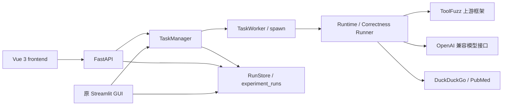

# ToolFuzz 图形化测试平台

基于 [ETH Zurich SRI Lab 的 ToolFuzz](https://github.com/eth-sri/ToolFuzz) 构建的本科毕业设计项目，为 LLM Agent 工具测试提供图形化配置、任务执行、取消、结果展示和历史实验浏览能力。

主要使用 **Vue 3 + TypeScript + Vite** 作为前端，**FastAPI + Uvicorn** 作为服务层，复用 ToolFuzz 的 Runtime / Correctness 测试能力。Streamlit 为作为原开发方案暂时保留。

本项目面向可信本机的研究与开发环境。真实测试会调用模型及外部工具服务，可能产生费用；自动化离线测试与真实模型验收分别记录。

## 项目背景与目标

LLM Agent 能否正确使用工具，不仅取决于模型回答，还取决于工具输入、执行异常和输出语义。平台将已有 ToolFuzz 测试流程组织为可配置、可观察、可保存的实验，便于开展毕业设计中的功能验证和实验分析。

本项目新增工作集中在界面、兼容适配、任务生命周期、多模型接入、统一结果及报告管理。ToolFuzz 的原始测试框架属于上游项目；本仓库通过子模块保留其来源，不将其表述为本毕业设计原创算法。

## 主要功能

| 功能 | 当前实现 |
| --- | --- |
| 测试配置 | Runtime / Correctness，工具、迭代次数、模型及调用参数配置 |
| 工具选择 | DuckDuckGo Search、PubMed |
| 多模型接入 | DeepSeek、OpenRouter、SiliconFlow、Qwen、Custom OpenAI-Compatible |
| 模型角色 | 简单模式共用配置；高级模式分别配置 Prompt、Agent、Judge |
| 凭证来源 | 临时 API Key 密码输入，或服务器环境变量 |
| 任务管理 | 单个 TaskManager 内单任务执行、状态轮询、配置锁定、取消及 Worker 回收 |
| 结果展示 | 实验摘要、用例、工具调用参数、Agent Trace 和可用原始数据 |
| History | 已保存记录列表、时间排序、测试类型筛选、Vue 分页和详情 |
| 报告 | 可用 JSON 下载、HTML 打开及报告图片资源 |
| API 文档 | `/docs`，Swagger UI 的 JS/CSS 等资源在本地托管 |
| 本地启动 | `./run_dev.sh` 启动 FastAPI 和 Vue，Ctrl+C 关闭本次启动的服务 |

History 保持只读，不提供历史记录编辑、删除、对比或一键复测。

## 系统架构



<!-- 图中 TaskManager 表示复用同一套代码，**不代表两个服务共享一个内存实例**：

- `frontend/` 是 Vue 界面，通过 HTTP 访问 `main/api/`，不直接调用模型 Provider。
- `GUI/` 既有原 Streamlit 页面，也有 FastAPI 仍在使用的 `services/task_manager.py` 和 `services/task_worker.py`，不能整体删除。
- 两套界面复用 `main/core/` 和默认实验存储。分别启动 Streamlit 与 FastAPI 时，运行中的任务状态属于各自进程，单任务限制也各自生效。**不建议同时使用两个界面执行实验。** -->

### 技术栈

以下是当前工作环境与文件中核实的版本。

| 层次 | 技术与版本 |
| --- | --- |
| Python | 3.10；当前解释器为 3.10.12 |
| 模型与 Agent | LangChain 1.3.18、langchain-core 1.6.1、langchain-openai 1.6.0、LangGraph 1.2.11、OpenAI SDK 3.6.0 |
| 工具封装 | langchain-community 0.4.2 |
| HTTP 服务 | FastAPI 0.115.14、Starlette 0.46.2、Uvicorn 0.52.4 |
| 原界面 | Streamlit 1.63.0 |
| Vue 前端 | Vue 3.5.45、Vue Router 4.6.5、TypeScript 5.9.3、Vite 7.3.8 |
| 前端验证 | Vitest 4.1.12、Vue Test Utils 2.4.6、vue-tsc 3.3.14 |
| 存储 | 本地 UTF-8 JSON、HTML 和报告资源，无数据库 |

## 项目目录

```text
.
├── frontend/                 # Vue 界面、API Client、前端测试及 npm 锁文件
├── GUI/
│   ├── app.py                # 原 Streamlit 入口
│   ├── components/           # 原界面展示组件
│   ├── services/             # 两种入口复用的 TaskManager、Worker 等服务
│   └── tests/                # Python 离线回归测试
├── main/
│   ├── api/                  # FastAPI 工厂、接口及本地 Swagger 资源
│   ├── core/                 # Runner、模型适配、RunResult、RunStore
│   ├── compat/               # 现有 ToolFuzz / LangChain 兼容层
│   ├── experiments/          # 原实验入口，执行可能调用真实模型
│   ├── tests/                # 原模型/工具验证脚本，不属于默认离线测试入口
│   └── results/              # 旧历史结果，本地保留，Git 忽略
├── ToolFuzz/                 # 原始上游 Git Submodule
├── experiment_runs/          # 新实验记录，本地生成，Git 忽略
├── docs/                     # 本地开发和验收文档，Git 忽略
├── scripts/setup_dev_path.py # 原路径配置脚本，新 API 启动不依赖重跑它
├── requirements-api.txt      # FastAPI / Uvicorn 依赖声明
├── run_api.sh                # 独立启动后端
├── run_dev.sh                # 一键启动本地前后端
└── README.md
```

本地另有 `ToolFuzz/.venv/` 和根目录 `.venv/api-deps/`；它们不是需要上传的项目源码，也不会随 Git 克隆提供。

## 环境要求与安装

### 已有可运行环境

当前已验证入口是 **WSL/Linux + Bash**。需要 Git、Python 3.10，以及符合 `frontend/package.json` 要求的 Node.js（`^20.19.0 || >=22.12.0`）和 npm；当前使用 Node 20.20.2 / npm 10.8.2。

启动前应具备：

1. `ToolFuzz/` 子模块源码，版本与下文一致。
2. 可执行的 `ToolFuzz/.venv/bin/python`，以及 ToolFuzz、LangChain/LangGraph、工具和 Streamlit 依赖。
3. 根目录 `.venv/api-deps/` 中的 API 依赖。该目录是 `pip --target` 安装目录，不是第二个完整虚拟环境。
4. `frontend/node_modules/` 中已安装的前端依赖。
5. 空闲的 `127.0.0.1:8000` 和 `127.0.0.1:5173`。

现有环境已经满足以上条件时，直接进入“一键启动”，无需重新安装、激活其他环境或重跑路径脚本。

### 新机器首次准备

以下命令供使用者在**新的克隆目录**手动执行；仓库地址需要替换为本项目发布后的地址，不能用上游 ToolFuzz 地址代替。

```bash
git clone --recurse-submodules '<本项目的GitHub仓库地址>' toolfuzz
cd toolfuzz
git submodule status
```

**复现限制：当前没有覆盖 Python 核心与全部传递依赖的完整锁文件。** 下方使用已核实的主要版本给出准备示例，尚未在全新机器完成整套安装验收；完成安装后应执行导入检查和离线回归。不要复制开发机的 `.venv`，也不要在已有正常环境上直接重复这些安装命令。

```bash
# 仅适用于新目录中尚不存在的 Python 虚拟环境
python3.10 -m venv ToolFuzz/.venv
ToolFuzz/.venv/bin/python -B -m pip install ./ToolFuzz \
  'langchain==1.3.18' 'langchain-core==1.6.1' \
  'langchain-openai==1.6.0' 'langgraph==1.2.11' \
  'langchain-community==0.4.2' 'openai==3.6.0' \
  'streamlit==1.63.0' 'ddgs==9.16.0' 'xmltodict==1.0.4' \
  'requests==2.34.2' 'httpx==0.28.1' 'pydantic==2.13.5'

# API 依赖放在根目录的独立目标目录中
ToolFuzz/.venv/bin/python -B -m pip install \
  --target .venv/api-deps -r requirements-api.txt \
  'starlette==0.46.2' 'pydantic==2.14.3'

# 根据已有 package-lock.json 安装前端依赖
(cd frontend && npm ci)
```

主 Python 环境和 API 依赖目录的 Pydantic 版本可以不同；启动 API 时后者优先。`run_api.sh` 实际检查 **FastAPI 0.115.14 / Starlette 0.46.2**，因此安装时显式指定 Starlette，而不能只依赖未锁定的传递依赖解析。

在项目根目录进行无模型调用的导入检查：

```bash
PYTHONPATH="$PWD/.venv/api-deps:$PWD:$PWD/ToolFuzz" \
PYTHONDONTWRITEBYTECODE=1 ToolFuzz/.venv/bin/python -B -c \
"import fastapi, starlette, uvicorn; import main.api.app; import main.core.runtime_runner, main.core.correctness_runner; print('FastAPI:', fastapi.__version__, 'Starlette:', starlette.__version__, 'Uvicorn:', uvicorn.__version__); print('Imports OK')"
```

安装依赖、克隆子模块需要联网；导入检查不调用收费模型 API。不要直接照搬上游历史 Conda 环境中的本机路径，也不要修改上游源码来补安装。

## 一键启动

在项目根目录执行：

```bash
./run_dev.sh
```

| 服务 | 地址 |
| --- | --- |
| Vue 工作台 | http://127.0.0.1:5173 |
| FastAPI 健康检查 | http://127.0.0.1:8000/api/v1/health |
| Swagger UI | http://127.0.0.1:8000/docs |
| OpenAPI 定义 | http://127.0.0.1:8000/openapi.json |

脚本使用自身位置定位项目，不依赖当前激活的 Python 环境或终端目录。它复用 `run_api.sh`，后端就绪后启动 Vite，不启动 Streamlit，不自动安装依赖或打开浏览器。

按 **Ctrl+C** 关闭本次启动的服务。端口被占用时脚本报错，不会终止原占用进程；关闭自己原先启动的重复服务后再运行即可。如果异常服务超过退出等待时间，脚本报告 PID 和错误，不强行杀死尚可能持有 Worker 的后端。

### 单独启动后端

```bash
./run_api.sh
# 后端单独运行时可以修改端口
API_PORT=8001 ./run_api.sh
```

后端默认仅监听 `127.0.0.1:8000`，固定单个 Uvicorn Worker，不使用 `--reload`。`WEB_CONCURRENCY`、`UVICORN_WORKERS` 等冲突设置会被拒绝。一键开发入口固定使用 8000，与当前 Vite `/api` 代理一致；不要在一键模式下改成其他后端端口。

原环境曾存在 Starlette 版本优先级冲突。启动脚本显式设置 `.venv/api-deps`、项目根目录、`ToolFuzz/` 的 `PYTHONPATH` 顺序以及 `PYTHONDONTWRITEBYTECODE=1`，不依赖 `.pth` 保证优先级，也不修改全局 Shell 配置。`scripts/setup_dev_path.py` 仍会写入三条路径，通常无需再次运行。

### 原 Streamlit 入口

需要查看旧界面时，可在项目根目录单独运行：

```bash
PYTHONPATH="$PWD:$PWD/ToolFuzz" PYTHONDONTWRITEBYTECODE=1 \
  ToolFuzz/.venv/bin/python -B -m streamlit run GUI/app.py \
  --server.address 127.0.0.1 --server.port 8501
```

旧界面的模型配置能力以其实际控件为准；本轮 Vue 的临时密钥输入功能没有移植到旧页面。不要同时从两种入口启动实验。

## 运行流程与测试类型

1. 打开 Vue 工作台，选择测试类型、工具和迭代次数。
2. 选择 Provider，填写账户实际可用的 Model ID，配置凭证；必要时使用高级模式分别设置角色。
3. 启动任务，FastAPI 返回 `task_id`，TaskManager 在独立 spawn Worker 中执行 Runner。页面轮询状态，运行期间锁定配置。
4. 正常结束后回收 Worker、发布可用报告并持久化；取消时先停止任务进程树，确认回收后才能开始新任务。
5. 查看当前结果或进入 History，打开已保存用例、Trace 和报告。

| 类型 | 作用 | 模型角色 | Iterations 对应含义 |
| --- | --- | --- | --- |
| Runtime | 探索可能触发工具运行异常的输入，并记录实际触发情况 | Prompt、Agent | `fuzzer_iters`，输入探索迭代次数 |
| Correctness | 生成测试问题与参数，结合 Agent 执行和 Judge 检查结果一致性 | Prompt、Agent、Judge | `prompt_set_iters`，Prompt Set 迭代次数 |

最终用例数和模型调用次数不等于 Iterations；一次迭代内部可能包含多次模型和工具调用。首次真实实验可从 1 次迭代开始。

`completed` 表示执行流程结束，不表示工具没有问题。Runtime 的成功触发数、Correctness 的工具失败数来自各自判定，不能混用。模型鉴权、服务错误和超时属于执行故障，不应解释为 ToolFuzz 已发现工具缺陷。任务状态与持久化状态分别展示，失败或取消的记录可能没有完整报告。

## 多模型与 API Key 配置

| Provider ID | 默认 Base URL | 服务器默认环境变量 |
| --- | --- | --- |
| `deepseek` | `https://api.deepseek.com` | `DEEPSEEK_API_KEY` |
| `openrouter` | `https://openrouter.ai/api/v1` | `OPENROUTER_API_KEY` |
| `siliconflow` | `https://api.siliconflow.cn/v1` | `SILICONFLOW_API_KEY` |
| `qwen` | `https://dashscope.aliyuncs.com/compatible-mode/v1` | `DASHSCOPE_API_KEY` |
| `custom` | 使用者填写 | 环境变量模式下填写变量名 |

默认地址是当前适配配置，Provider 的实际地域、账户和模型可用性以其控制台为准。Model ID 不由平台保证可用；Agent 所用模型应支持 OpenAI 兼容的工具调用。适配五类 Provider 不等于所有模型、参数或推理模式均已验证。

### 直接输入（默认）

选择 Provider → 填写 Model ID → 在密码框粘贴 API Key。简单模式共用一份配置和密钥；高级模式可以给各角色使用不同 Provider、模型和密钥。可手动清空，提交后密码输入清空，页面刷新后重新输入。

### 服务器环境变量（高级）

在启动服务的终端设置所需变量，再在页面选择“使用服务器环境变量”。例如 Bash 中可以隐藏输入并避免将密钥字面值写入命令历史：

```bash
read -rsp 'DeepSeek API Key: ' DEEPSEEK_API_KEY
printf '\n'
export DEEPSEEK_API_KEY
./run_dev.sh
```

其他 Provider 使用上表的对应变量，或在高级配置中指定自己的变量名。运行中的后端不会自动获得另一个终端后来设置的环境变量，需要在正确终端重新启动服务。`credentials_configured` 只说明默认环境变量有值，不验证密钥有效性，也不阻止使用页面输入的临时密钥。

本项目不自动读取 `.env` 文件。不要把密钥写进源码、README、截图或 GitHub Issue。

### 凭证安全边界

临时凭证使用独立的 `temporary_credentials` 请求结构，服务端以 `SecretStr` 接收，经过 TaskManager 和 spawn 内存通信传入 Worker；模型按角色优先使用临时密钥，未提供时回退服务器环境变量。

临时密钥不混入持久化 ModelConfig/RunConfig，不通过 URL、命令行或临时文件传递，不写入全局凭证环境变量，也不写入浏览器 localStorage、sessionStorage 或 IndexedDB。正常完成、失败和取消回收后清除任务持有引用；结果、报告及 Worker 输出有脱敏处理。

这些措施不等于永久密钥管理或物理内存擦除。请求期间浏览器和 SDK 仍需在内存中持有密钥，浏览器开发工具可以查看本人提交的请求。当前服务没有身份认证或生产级 HTTPS/访问控制，**仅限可信本机，不应直接开放局域网或公网**。

## API 服务

业务接口统一使用 `/api/v1` 前缀，当前有九种操作：

| 方法 | 路径 | 用途 |
| --- | --- | --- |
| GET | `/api/v1/health` | 服务健康检查 |
| GET | `/api/v1/providers` | Provider 列表及默认凭证配置状态 |
| GET | `/api/v1/tools` | 已注册工具列表 |
| POST | `/api/v1/tasks` | 创建 Runtime / Correctness 任务 |
| GET | `/api/v1/tasks/{task_id}` | 查询任务状态 |
| POST | `/api/v1/tasks/{task_id}/cancel` | 请求取消当前活动任务 |
| GET | `/api/v1/runs` | History 列表，支持 `limit`、`offset`、`test_type` |
| GET | `/api/v1/runs/{run_id}` | 读取保存的完整运行结果 |
| GET | `/api/v1/runs/{run_id}/reports/{filename}` | 读取允许公开的报告或资源 |

请求参数和返回结构请查看启动后的 `/docs` 或 `/openapi.json`。本地 Swagger 关键资源位于 `main/api/static/swagger-ui/`，不需要运行时从 jsDelivr 下载。

下列查询不会触发模型：

```bash
curl http://127.0.0.1:8000/api/v1/health
curl http://127.0.0.1:8000/api/v1/providers
curl 'http://127.0.0.1:8000/api/v1/runs?limit=10&offset=0'
```

创建有效任务可能产生模型费用。轮询接口的 `200 OK` 只代表查询成功，实际执行状态需要查看响应中的 `status`。正常状态为 `running → completed / failed`；取消为 `running → cancelling → cancelled`。后端尚未确认进程树停止时不会释放任务槽。

## History 与实验数据

History 从磁盘读取统一 RunResult，服务重启后仍可查看已保存记录，不需要重新执行实验。Vue 列表默认按时间从新到旧，支持类型筛选和分页；详情复用结果组件，缺少字段、Trace 或报告时显示可用信息。

```text
experiment_runs/
└── <task_id>/
    ├── run_result.json
    ├── runtime.json 或 correctness.json
    ├── runtime.html 或 correctness.html
    └── toolfuzz.png                     # 报告需要且生成成功时存在
```

- `metadata.task_id` 是 GUI/API 任务 ID，`metadata.run_id` 是 Core Runner 的运行 ID，两者可能不同；API History 详情使用 Core `run_id`。
- RunResult 保存配置摘要、状态、统计、用例、错误和已生成报告路径，采用 UTF-8 JSON 原子写入。
- 新持久化记录优先使用相对于实验根目录的报告路径；旧绝对路径按严格任务目录规则兼容读取，不批量改写旧记录。
- 报告下载限制在本任务已声明、实际存在的允许文件内，拒绝路径穿越、跨任务和外部符号链接。
- History 读取 `experiment_runs/`，不会自动迁移或扫描旧 `main/results/` 散装报告。旧数据保留原处。
- `experiment_runs/`、`main/results/`、`docs/`、虚拟环境、构建产物、日志和 ZIP 备份目前均被 Git 忽略，不随源码发布。

实验内容可能含生成的提示词、工具响应、Trace、网址和本机错误路径。即使已做凭证脱敏，也应在公开实验数据前逐项审查。浏览历史不等于断点续跑，已结束或服务退出后的任务不会自动恢复执行。

## 自动化测试

以下是 **P2.3.1 阶段记录的结果**，并已与本地阶段报告和最终日志核对；本次 README 发布准备没有重新运行测试或收费模型调用。

| 检查 | 阶段结果 |
| --- | --- |
| 前端单元测试 | 48 PASS |
| HTTP 联调测试 | 12 PASS |
| Python 完整回归 | 112 PASS |
| TypeScript 检查和 Vue 构建 | PASS |

在已准备好的环境中运行前端检查：

```bash
(cd frontend && npm run test:unit -- --run)
(cd frontend && npm run type-check)
(cd frontend && npm run build)
```

Python 离线回归在项目根目录运行，使用当前验证过的 API 依赖优先级：

```bash
PYTHONPATH="$PWD/.venv/api-deps:$PWD:$PWD/ToolFuzz" \
PYTHONDONTWRITEBYTECODE=1 ToolFuzz/.venv/bin/python -B \
  -m unittest discover -s GUI/tests -v
```

该套件使用临时存储、模拟密钥和 HTTP 替身，包含真实 spawn Worker、本机 HTTP 和启动脚本验证，不调用收费模型 API。启动相关测试需要 8000/5173 空闲，运行前应先停止自己开启的开发服务。不要以 `main/tests/` 或上游全部测试替代该入口；其中有真实模型/外部服务脚本。

HTTP 联调需先通过 `./run_dev.sh` 启动服务，再在另一终端执行：

```bash
(cd frontend && npm run test:integration)
```

**现有 HTTP 联调依赖本机已有的 History 样例**，包括 `local_echo`、取消记录以及 JSON/HTML 报告；全新克隆的实验目录为空时不能直接复现 12 PASS。套件中的任务生命周期部分使用临时离线执行器，但读取现有 History 的部分不是自包含夹具。不要为了满足测试而上传私人实验记录或调用收费模型冒充样例。

Mock/HTTP 替身验证不等于真实收费 Provider 验收；Vue Test Utils 的 DOM 渲染也不能替代真实浏览器布局和控制台检查。

## 项目状态与已知限制

目前已完成 P0–P2.3.1 范围的功能开发。P0 持久化、P1 History、P1.1 取消及部分后续阶段已有用户人工检查记录；P2.3/P2.3.1 的最终 Vue 浏览器、全部 Provider 组合和真实调用期间取消场景，仍需按实际场景补充验收，不能将历史某次模型成功推广为全部场景通过。

当前限制包括：

- 面向本地开发，不提供生产部署、用户权限、数据库、任务队列、并行实验或断点恢复。
- 单 Worker 与进程内 TaskManager 是部署约束；不支持多个 API Worker 共享活动任务。
- Bash 启动流程在 WSL/Linux 使用；Worker 保留 Windows Job Object 分支，但不代表已完成 Windows 原生启动与回收实机验收。
- 外部搜索服务、网络、模型限流、余额、工具调用能力和返回格式会影响真实实验；失败摘要不一定包含足够信息定位供应商故障。
- 取消可以停止本地后续执行，但已经发送的远端请求不一定可撤销或免计费。强制退出可能跳过第三方 finalizer，不保证所有依赖永不产生资源清理告警。
- Python 核心依赖尚未完整锁定，新机器安装尚需验收；前端已有 `package-lock.json`。
- 旧 HTML 报告模板可能引用外部样式；Swagger UI 本地化不等于所有历史 HTML 都完全离线自包含。
- P2.3 报告曾记录前端开发依赖的 4 项 moderate npm audit 提示；这不是本次重新审计的数量，后续需单独复核，不能据此认定运行时代码存在同样风险。

## 上游来源与许可证

| 项目 | 核实信息 |
| --- | --- |
| 上游仓库 | https://github.com/eth-sri/ToolFuzz |
| 子模块目录 | `ToolFuzz/`，Git 模式 `160000` |
| 固定 Commit | `26d14fc72872033f32d96c05d53440f10ca552e8` |
| 上游许可证 | MIT，Copyright (c) 2025 SRI Lab, ETH Zurich |

上游内容以固定提交的 [ToolFuzz LICENSE](https://github.com/eth-sri/ToolFuzz/blob/26d14fc72872033f32d96c05d53440f10ca552e8/LICENSE) 为准。主仓库记录 `.gitmodules` 和子模块提交引用，正常推送主仓库不会把整个上游源码作为普通目录提交；复现时应递归克隆子模块。

本毕业设计新增平台代码位于 `frontend/`、`GUI/`、`main/` 及启动入口等目录。**项目根目录目前尚无独立 LICENSE**，上游的 MIT 不应被当作本平台新增代码已经作出的许可证选择；项目作者需在公开发布前确认新增代码的授权方式及学校要求。

第三方静态资源包括 Swagger UI Dist 5.35.0（Apache-2.0），其来源、完整性校验与许可保存在 `main/api/static/swagger-ui/manifest.json`、`LICENSE`、`NOTICE` 和 `swagger-ui-bundle.js.LICENSE.txt` 中。ToolFuzz 报告模板及 logo 的使用也应保留上游来源说明。其他 Python/npm 依赖分别遵循各自许可证。

## 致谢

感谢 ETH Zurich SRI Lab 提供 ToolFuzz 上游框架，以及 LangChain/LangGraph、FastAPI、Vue、Vite、Streamlit 和相关开源依赖的维护者。本项目在其基础上完成面向毕业设计的图形化平台和工程集成。
